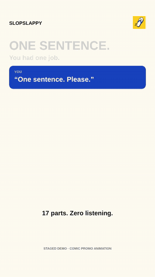

  

<h1 align="center">SlopSlappy</h1>

  Your AI said something stupid. Slap it. 
  A Chrome extension that screams at ChatGPT, Claude, Gemini and Manus — in 12 languages.

  <a href="https://slopslappy.com">slopslappy.com</a> ·
  <a href="../../releases/latest">Download</a> ·
  <a href="#install">Install</a> ·
  <a href="#privacy">Privacy</a>

  

## What it does

A small slipper appears next to every AI answer. Click it and a voice says what you were already thinking — out loud, in your language, at a volume your coworkers can hear.

- **12 languages**: English, Hindi, Hinglish, Punjabi, Spanish, French, German, Portuguese, Italian, Japanese, Korean, Russian
- **2,522 bundled clips** — Man and Woman voices, three intensity tiers (Strong, Nuclear, Meltdown), plus full rants, dry sighs, and radio / monster effects
- **12 original personas** — Furious Desi Uncle, No-Nonsense Desi Aunty, Hindi Film Villain, Telenovela, Caesar, Shakespeare and friends. All AI-performed fictional characters; none are real people.
- **Hold to scream** — hold the slipper and scream into your mic; it measures how loud you are and reacts. Nothing is recorded.
- **My Voice** — record your own rant and use it instead. Stays on your machine.
- **Works on** chatgpt.com, claude.ai, gemini.google.com and manus.im

Everything is bundled. No account, no server, no internet after install.

## Install

**From the Chrome Web Store** — coming soon. Until then:

**From source (30 seconds)**

1. Download the [latest release](../../releases/latest) zip and unzip it, or clone this repo.
2. Open `chrome://extensions`, turn on **Developer mode** (top right).
3. Click **Load unpacked** and pick the folder that contains `manifest.json`.
4. Open ChatGPT (or Claude, Gemini, Manus), ask it something, and click the slipper next to the answer.

Works in Chrome, Edge, Brave, Arc and anything else Chromium-based.

## Using it

- Click the slipper to start or stop.
- Click **⋯** to open settings: language, voice, intensity, effect, personas, timer, My Voice.
- Press **Escape** to close settings and stop playback.
- If the slipper lands in the corner instead of beside the answer (sites change their layout a lot), open settings and use **Place beside answer…**, then click any icon under the AI's reply.

Default out of the box is Punjabi, Man, Clear, 60 seconds. Nothing plays until you click.

## Privacy

Short version: SlopSlappy never phones home.

- Permissions are `activeTab` and `scripting` only — the minimum to draw a button on the page you're looking at.
- It does not read, store or send your chat. Placement logic looks at the page's buttons (Copy, Retry, Regenerate), never the answer text.
- All audio is bundled in the extension. No downloads, no streaming, no remote code, no analytics.
- Hold-to-scream measures microphone volume in the moment and discards it. It does not record.
- My Voice records only after you press Start and saves only after you press Save, to your browser's local IndexedDB. Uninstalling the extension deletes it.

Full policy: [slopslappy.com/privacy](https://slopslappy.com/privacy)

## Contributing

Issues and pull requests welcome — especially better placement rules when a chat site changes its layout, and native-speaker notes on any clip that sounds off.

Want a language or persona that isn't here? Open an issue with the phrases you'd want (keep it to insults aimed at the AI, not at groups of people).

## License

- **Code** — [MIT](LICENSE). Do whatever you want.
- **Audio** (everything under `audio/`) and the mascot — [CC BY-NC 4.0](LICENSE-AUDIO.md). Free to use, share and remix with credit; not for resale or use in paid products.

All voices are AI-performed. Personas are original fictional characters and parodies, not celebrity voices, authentic recordings or historical quotations.

## Contact

hello@slopslappy.com · [X](https://x.com/slopslappyapp) · [TikTok](https://www.tiktok.com/@slopslappy) · [Instagram](https://www.instagram.com/slopslappy/)
